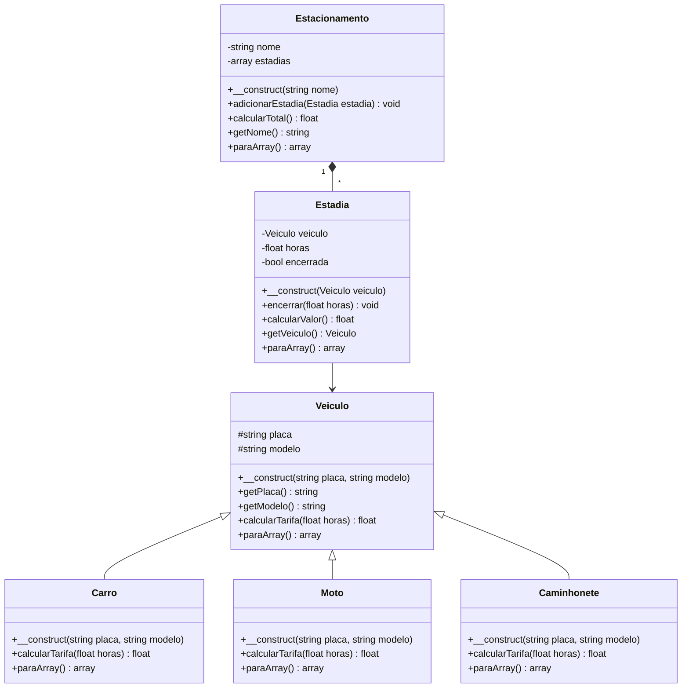

# Modelagem

## Diagrama de classes

O diagrama abaixo mostra as seis classes do sistema Estacionamento Central e como elas se relacionam.

## Justificativas

### Herança

A classe mãe do sistema é `Veiculo`. As classes `Carro`, `Moto` e `Caminhonete` são filhas dela, porque todas representam tipos de veículos.

Por exemplo, um carro é um veículo, uma moto é um veículo e uma caminhonete também é um veículo.

A classe `Veiculo` guarda as informações que todos possuem, como placa e modelo. Assim, não precisamos repetir essas informações em cada classe filha.

O método `calcularTarifa()` é sobrescrito nas três classes filhas, porque cada tipo de veículo possui um valor diferente por hora: carro custa R$ 6, moto custa R$ 3 e caminhonete custa R$ 8.

Isso também permite usar o polimorfismo, já que podemos chamar o mesmo método em veículos diferentes e receber o valor correspondente a cada tipo.

### Composição

A classe `Estacionamento` guarda uma lista de objetos da classe `Estadia`.

Cada estadia representa a permanência de um veículo no estacionamento, com o tempo utilizado e o valor cobrado.

Essa relação é de composição porque o estacionamento tem várias estadias, mas uma estadia não é um estacionamento.

O método `adicionarEstadia()` coloca uma nova estadia na lista, enquanto `calcularTotal()` percorre os registros e soma os valores arrecadados.

Além disso, cada objeto `Estadia` guarda um objeto `Veiculo`, permitindo descobrir qual veículo foi estacionado e calcular o valor correspondente.

### Encapsulamento

Os atributos do sistema são `private` ou `protected`, ou seja, não podem ser alterados livremente de fora das classes.

Na classe `Veiculo`, os atributos `placa` e `modelo` são `protected`, para que as classes filhas possam utilizá-los. Os métodos `getPlaca()` e `getModelo()` permitem consultar essas informações.

Na classe `Estadia`, os atributos são privados. O método `getVeiculo()` permite consultar o veículo, e o método `encerrar()` controla o registro das horas e o encerramento da estadia.

Não existe um setter livre para as horas, porque elas precisam passar pelas validações. O sistema recusa valores iguais ou menores que zero e também impede encerrar a mesma estadia duas vezes.

Na classe `Estacionamento`, o nome e a lista de estadias são privados. O método `getNome()` permite consultar o nome, enquanto `adicionarEstadia()` controla a inclusão de novos registros.

Dessa forma, as informações ficam protegidas e as alterações passam pelos métodos apropriados.